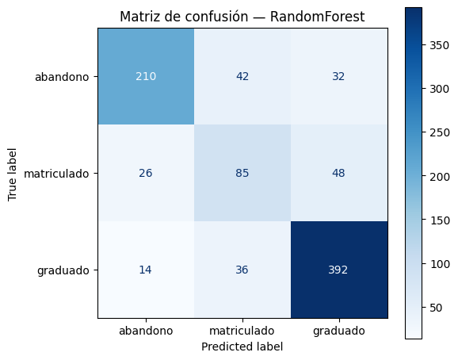
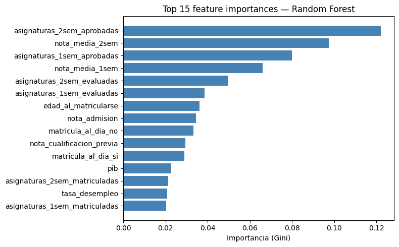
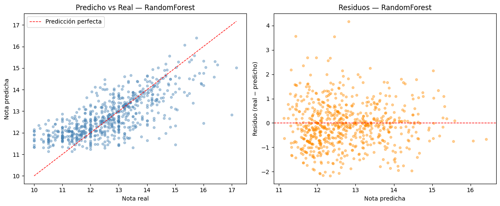
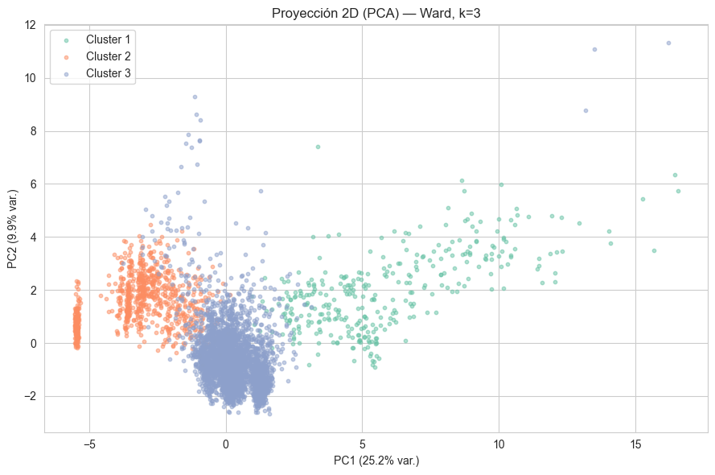

# EduPredict

**Predicting academic success in higher education with machine learning.**


EduPredict is an end-to-end machine learning project on a dataset of ~4,400 university students. It covers the whole pipeline (EDA, data cleaning, model selection with cross-validation, evaluation and interpretation) across three complementary tasks:

| Task | Question | Best model | Test result |
|---|---|---|---|
| **Multiclass classification** | Will the student drop out, stay enrolled or graduate? | Random Forest | **Macro F1 = 0.72** (vs 0.34 baseline) |
| **Regression** | What will the student's 2nd-semester average grade be? | Random Forest | **R² = 0.53**, RMSE −31.7 % vs baseline |
| **Clustering** | Are there natural student profiles? | Ward hierarchical clustering | **3 profiles**, bootstrap ARI = 0.92 |

> Final project for the *Machine Learning* course, Universidad Pontificia Comillas (ICAI).

---

## Highlights

- **Rigorous EDA-driven preprocessing**: every cleaning decision (text-encoded nulls, cardinality reduction, outlier handling) is justified by the exploratory analysis.
- **Leakage-safe by design**: the regression loader aborts if it finds any 2nd-semester variable other than the target, and all transformations live inside scikit-learn `Pipeline`s so they are fitted only on the training folds.
- **Honest evaluation**: imbalance-aware metric (macro F1), `class_weight='balanced'`, stratified splits and `DummyClassifier` / `DummyRegressor` baselines.
- **Model comparison**: KNN, Logistic Regression (ElasticNet) and Random Forest for classification; Linear, Ridge, Lasso, ElasticNet, SVR (linear and RBF) and Random Forest for regression, all tuned with `GridSearchCV`.
- **Interpretability**: Gini feature importance, Lasso coefficients, residual diagnostics and cluster profiling validated against the real outcome.
- **Reproducible**: all random seeds fixed (`random_state=0`).

## Results

<p align="center">
  
  
</p>

**Classification.** Random Forest and ElasticNet logistic regression perform almost identically (macro F1 0.724 vs 0.721), both more than doubling the best dummy baseline. Dropout and graduation are detected well; the *enrolled* class is the hardest, since it sits between the other two outcomes and is the smallest class.

<p align="center">
  
</p>

**Regression.** All models land around R² ≈ 0.50, with Random Forest slightly ahead (R² = 0.53, MAE = 0.69 grade points). First-semester performance is by far the dominant predictor. Students with a 0.0 average (who dropped out before being assessed) are filtered out to avoid fitting two different populations.

<p align="center">
  
</p>

**Clustering.** Ward linkage on a PCA-reduced space (90 % variance) finds three stable profiles (bootstrap ARI = 0.92 ± 0.05). Without ever seeing the target, one of the clusters concentrates **82 % dropouts**, showing that the profiles capture real differences in student trajectories.

## Project structure

```
EduPredict/
├── src/                         # Reusable logic (imported by the notebooks)
│   ├── configuracion.py         # Project paths
│   ├── clean_data.py            # Cleaning pipeline and train/test splits
│   ├── clasificacion.py         # Task 1: classification
│   ├── regresion.py             # Task 2: regression
│   └── unsupervised.py          # Task 3: hierarchical clustering
├── notebooks/                   # Analysis, visualisations and conclusions
│   ├── 01_preprocesado.ipynb    # EDA + preprocessing
│   ├── 02_clasificacion.ipynb
│   ├── 03_regresion.ipynb
│   └── 04_unsupervised.ipynb
├── docs/images/                 # Figures used in this README
└── requirements.txt
```

`src/` holds the reusable logic and `notebooks/` call those functions, adding visualisations and commentary.

## Getting started

```bash
git clone https://github.com/javmartineez/EduPredict.git
cd EduPredict
pip install -r requirements.txt
```

The raw dataset is not included in the repository. Place it at `data/rendimiento_estudiantes.csv` (semicolon-separated) and run the notebooks **in order** the first time:

```
01_preprocesado.ipynb   →  generates data/processed/*.csv
02_clasificacion.ipynb  →  uses data/processed/datos_limpios_clasificacion_*.csv
03_regresion.ipynb      →  uses data/processed/datos_limpios_regresion_*.csv
04_unsupervised.ipynb   →  uses data/processed/datos_limpios_clasificacion_*.csv
```

Approximate run times on an 8-core machine: preprocessing < 1 min, classification 1–3 min, regression 2–4 min, clustering ~1 min. Figures, metrics and predictions are written to `results/`.

> **Low-core machines:** Random Forest and `GridSearchCV` use `n_jobs=-1` (all cores). On machines with 4 cores or fewer, change it to `n_jobs=2` in `src/clasificacion.py` and `src/regresion.py`, or shrink the hyperparameter grids in `definir_modelos_y_grids`.

## Tech stack

Python · pandas · NumPy · scikit-learn · SciPy · Matplotlib · seaborn · Jupyter

## Author

**Javier Martínez Berenguer** · [GitHub](https://github.com/javmartineez)
